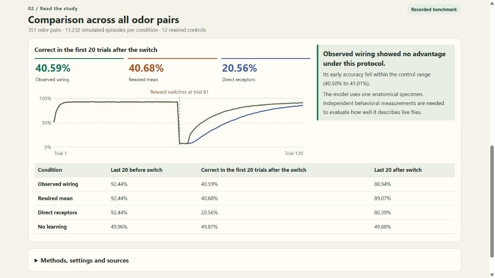

# FlyFlip Lab

How quickly does a learner change its choice when a reward moves? FlyFlip runs a two-odor reversal task on a measured fruit-fly projection-neuron to Kenyon-cell graph. The reward schedule and decisions belong to a simulation. The edges and odor-response values come from published experiments.

[Run FlyFlip Lab in your browser](https://saintedwind.github.io/flyflip/)



## Use the lab

Download [lab.html](results/lab.html) and open it in a browser. This self-contained file needs no installation, account or server. The language switch offers Persian and English.

1. Choose two measured odors and run the experiment. Each curve uses 32 simulated episodes per condition with balanced reward orders. The seed lets you repeat the run. The initial reward control sets the order for the sample episode.
2. Jump to trial 61 or move the trial slider. Compare the rewarded odor and the model's choice for observed wiring and the first rewired control.
3. Open **Study results** for the recorded benchmark across all 351 pairs. It has a different scope and uses NumPy's random generator. **Download result** exports your browser run with the odor identifiers, seed, traces, source revisions and benchmark digest.

Version 0.2 moves beyond the fixed [offline replay](results/replay.html). The browser runs the linear learner on demand using inner products of odor features derived from the pinned measurements. In the Python study, the two-score update already gives the same result as updating the full linear weight vector. Embedding those feature inner products makes the same update practical inside one HTML file. The [result record](results/study.json) contains the full benchmark curves and per-odor-pair early outcomes.

## Reproduce

From this directory, in a Python 3.11+ environment:

```sh
python -m pip install -e ".[test]"
python -m flyflip fetch
python -m flyflip run
python -m flyflip lab
python -m flyflip replay
python -m pytest -q
```

The fetch step needs public GitHub access. The model and tests then use the four local CSVs in `data/raw/`. Fetch and run both reject files that differ from their pinned SHA-256. The source files are excluded from version control and downloaded from the publishers' repositories. The simulation uses NumPy and SciPy on CPU. Python and library versions from the recorded run are in `results/study.json`.

The cross-runtime test uses Node.js. It compares browser and Python results for three measured odor pairs with identical random draws, including all 12 control circuits in the control average. A separate test compares the linear update against an explicit weight vector.

The regression workflow runs on pushes and pull requests with Python 3.11 and
3.12 and Node.js 22. It fetches the pinned measurement files, checks their
SHA-256 digests, and runs the source-integrity and Python/browser agreement
tests. This checks the simulation implementation; it does not validate the
model against biological behavior.

## Inputs and selection

1. **Anatomy.** [Zheng et al., Current Biology, 2022](https://pmc.ncbi.nlm.nih.gov/articles/PMC9413950/), Table S4, traces contacts at the PN bouton and KC claw level in the adult FAFB specimen. The [authors' table](https://github.com/bocklab/pn_kc/blob/96fb0de1833539a0643ecc136b8a0dcd50d34932/data/201001_bouton_claw_table.csv) contains 6,468 contact rows, 113 PNs and 1,354 KCs. Each observed PN/KC pair becomes one binary edge. Multiple contacts do not imply measured functional strength. The original MaleCNS plan changed after the bulk endpoint returned HTTP 403 in this environment. This analysis uses the separately published adult FAFB sample throughout.
2. **Responses.** [DoOR 2.0](https://pmc.ncbi.nlm.nih.gov/articles/PMC4766438/) combines normalized odor responses from published studies. The [pinned data directory](https://github.com/ropensci/DoOR.data/tree/db323a496577c4b4a72b5c2fcd1859e07521ffb5/data) provides the response matrix, receptor-to-glomerulus mapping, and chemical metadata. A response at the corresponding receptor is used as a proxy for PN input. The two sources were collected independently.
3. **Panel.** Require a chemical InChIKey and a name. Retain only one-to-one receptor/glomerulus mappings shared with the anatomical source. Sort mapped channels by nonmissing response count, with alphabetical glomerulus tie-breaking. Take the largest prefix that retains at least 24 complete compounds across at least eight channels. Missing measurements are excluded without imputation. The rule retained 27 compounds, 18 channels, 36 PNs, 1,146 connected KCs and 2,418 binary edges.

## Experiment

Average input at each KC, keep the strongest positive responses in the top decile including cutoff ties, and normalize the resulting vector to unit length. Compare observed wiring to 12 directed bipartite rewires. Each rewire preserves every PN's outgoing degree and every KC's incoming degree. It uses five accepted endpoint swaps per edge. The rewires retain 11.0% to 13.0% of original edges. Also run the same learner on the normalized receptor values directly and a fixed readout as a chance control.

For each of 351 unordered pairs, run both initial reward assignments with 16 replicates per assignment. The two odors remain available on each trial. The simulated reward goes from the first assigned odor to the other after 60 trials. A linear readout learns online from the chosen route's reward prediction error. Its step size is 0.30 and it explores randomly with probability 0.15. Each condition shares the same random exploration and tie-break actions for paired comparisons. All conditions use the same fixed protocol.

The main descriptive outcome is correct choices over the first 20 trials after the switch. This window measures persistence and early adaptation together. Its immediate drop is expected when the previously learned route loses its reward. The demo pair is selected by median receptor-vector cosine similarity, independently of performance.

## Recorded results

Each condition has 11,232 simulated episodes on the same set of measured odor profiles.

| Representation | Last 20 before switch | First 20 after switch | Last 20 after switch |
|---|---:|---:|---:|
| Observed wiring | 92.44% | 40.59% | 88.94% |
| Mean across 12 rewires | 92.44% | 40.68% | 89.07% |
| Direct receptor input | 92.44% | 20.56% | 80.39% |
| No learning | 49.96% | 49.87% | 49.88% |

Observed wiring was inside the rewired range of 40.50% to 41.01% on the main outcome, 0.09 percentage points below the rewire mean. Both sparse representations recovered sooner in this setup than direct receptor input. That contrast changes the encoding and feature dimension as well as the wiring. The observed-versus-rewired comparison is the topology comparison.

These are descriptive results for one sampled anatomical graph, one fixed protocol and a complete-case odor panel. Episodes reuse compounds and are not independent biological observations. The source graph does not provide synaptic strengths or measured plasticity, and no behavioral measurements were used as evaluation targets. The model tests computational reversal with a learned readout. Biological reversal learning is described by [McCurdy et al., Nature Communications, 2021](https://pmc.ncbi.nlm.nih.gov/articles/PMC7893153/).
